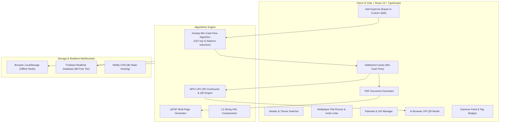

# ⚡ KharchaSplit

> **An Indian bachelor, flatmate & hostel expense ledger with algorithmic debt minimization, NPCI UPI deep-links, in-browser QR generation, and real-time multiplayer room syncing.**  
> *Zero backend servers required. 100% free deployment on Netlify.*

[](https://app.netlify.com/start)
[](https://www.typescriptlang.org/)
[](https://react.dev/)
[](https://tailwindcss.com/)
[](https://www.npci.org.in/)
[](#-dual-changeable-themes)

---

## 🌟 The Problem It Solves

Millions of Indian bachelors, students, and working professionals live in shared flats and hostels across metro cities like Bengaluru, Pune, Hyderabad, and Gurgaon. Everyday expenses are shared:
- *Kamla Didi (Maid salary)*
- *Ramu Kaka (Cook)*
- *Airtel/JioFiber Wi-Fi bill*
- *Daily Zepto/Blinkit milk & grocery deliveries*
- *20L Bisleri Water Cans & LPG Gas Cylinders*
- *Swiggy / Zomato food orders*

Apps like **Splitwise** have locked basic features behind aggressive paywalls. Furthermore, settling debts requires tedious calculator math followed by chasing flatmates on WhatsApp with UPI IDs.

**KharchaSplit** gives flatmates and hostel roommates a privacy-respecting, zero-login collaborative ledger that automatically calculates the **minimum number of direct payments** and lets roommates settle up instantly with **1-click UPI links and QR codes**.

---

## ✨ Key Features

1. ⚡ **Instant Equal vs. Custom Split with Itemized Notes:**
   - **Split Equally:** 1-tap division with rounding correction across all or selected flatmates.
   - **Custom Split:** Allocate exact rupee amounts per person with a dedicated inline note (e.g., *"Ordered 2 beers"*, *"Skipped dessert"*).
2. 🏷️ **Indian Quick Tags + Custom Tag Creator:**
   - Pre-loaded with Indian household essentials: `Maid Salary 🧹`, `Cook 👨‍🍳`, `Wi-Fi Bill 📶`, `Zepto / Blinkit 🛒`, `Electricity ⚡`, `Rent 🏠`, `Water Can 💧`, `Cylinder 🔥`, `Swiggy 🍔`.
   - Add and persist your own custom tags in real-time.
3. 📉 **Greedy Min-Cash Flow Algorithm:**
   - Collapses $N(N-1)/2$ complex inter-group debts into at most $N-1$ direct payments using graph reduction.
4. 🇮🇳 **NPCI UPI Protocol & In-Browser QR Codes:**
   - On Mobile: Tapping **"Pay via UPI"** triggers the native `upi://pay?pa=...&am=...` intent, opening GPay, PhonePe, or Paytm with the exact rupee amount pre-filled.
   - On Desktop: Generates a high-contrast QR code on an HTML5 canvas inside the browser for phone camera scanning.
5. 💬 **Mark-as-Paid with WhatsApp Settlement Confirmation:**
   - Toggle to send an auto-composed WhatsApp receipt to the receiver (with an option to uncheck and settle silently).
   - Confetti celebration upon settlement!
6. 📄 **1-Click PDF Export & WhatsApp Reports:**
   - Export and share full multi-page ledger PDFs or weekly/monthly expense summaries with spender leaderboards and category breakdowns.
7. 👥 **Multiplayer Collaborative Flat Rooms (Real-Time Sync):**
   - Create or join shared rooms (e.g., `#KORA-402`, `#HOSTEL-304`) with a 1-click invite link. Any expense added by one person instantly updates on everyone's phones in real-time via WebSockets.
8. 🎨 **Dual Changeable Themes:**
   - Switch seamlessly between a sleek **Crimson Dark Mode** (deep obsidian, crimson neon, amber gold) and an electric **Bumblebee High-Voltage Mode** (high-contrast yellow & matte charcoal).
9. 🛡️ **Zero-Database Offline & Cloud Resilient:**
   - Works offline in local mode or syncs live to Google Firebase Realtime Database ($0 Spark free tier).

---

## 📐 Architecture & Mathematical Foundation



### Greedy Min-Cash Flow Algorithm Complexity
1. Calculates net balance for every flatmate:
   $$\text{Balance}(u) = \sum \text{Paid}(u) - \sum \text{Owed}(u)$$
2. Partitions members into **Debtors** ($\text{Balance} < 0$) and **Creditors** ($\text{Balance} > 0$).
3. Greedily pairs the maximum debtor with the maximum creditor, settling $\min(-\text{Debit}, \text{Credit})$.
4. **Time Complexity:** $\mathcal{O}(V \log V)$ where $V$ is the number of flatmates (using sorting/heap).
5. **Space Complexity:** $\mathcal{O}(V)$.

---

## 🚀 Getting Started

### Prerequisites
- Node.js (v18 or higher)
- npm

### Installation
```bash
# Clone the repository
git clone https://github.com/Neeraj3102/kharchasplit.git

# Navigate to project directory
cd kharchasplit

# Install dependencies
npm install

# Start development server
npm run dev
```

Visit `http://localhost:5173` in your browser.

### Production Build
```bash
npm run build
```
The optimized static build will be generated in the `dist/` directory.

---

## 🌐 Deploying to Netlify ($0 Free Tier)

1. Push your repository to GitHub.
2. Log into [Netlify](https://app.netlify.com/).
3. Click **"Add new site"** $\rightarrow$ **"Import an existing project"** $\rightarrow$ Select your `kharchasplit` repo.
4. Netlify will auto-detect settings from `netlify.toml`:
   - **Build command:** `npm run build`
   - **Publish directory:** `dist`
5. *(Optional for live multi-device sync)* Add your free Firebase keys in Netlify Environment Variables:
   - `VITE_FIREBASE_API_KEY`
   - `VITE_FIREBASE_DATABASE_URL`
   - `VITE_FIREBASE_PROJECT_ID`
   - `VITE_FIREBASE_APP_ID`
6. Click **"Deploy site"** — your app is live on a free `*.netlify.app` domain!

---

## 📄 License
MIT License. Free for personal and open-source use.
